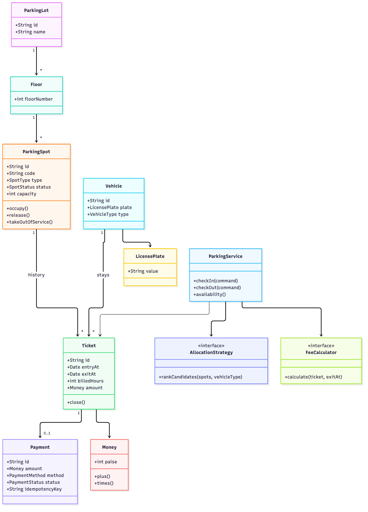
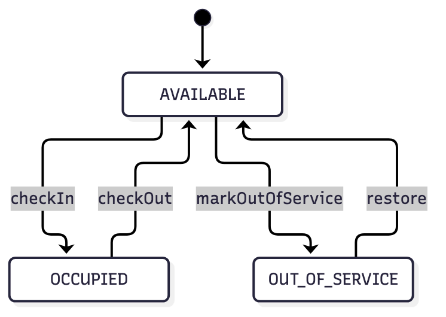
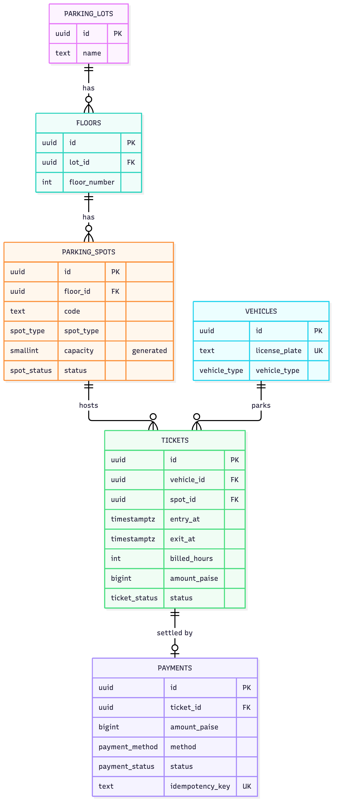
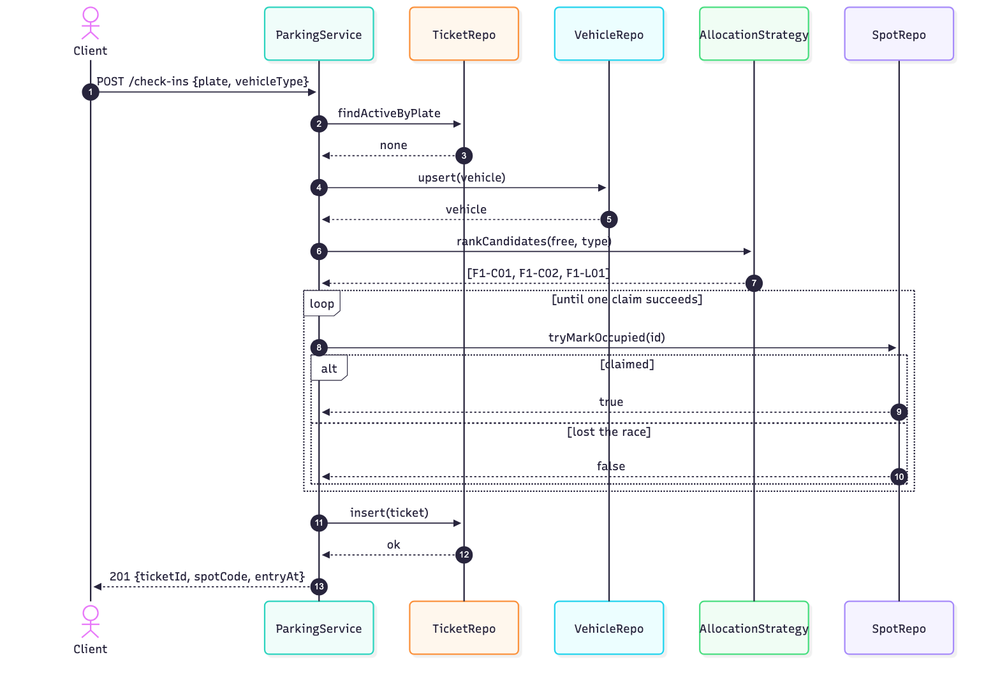
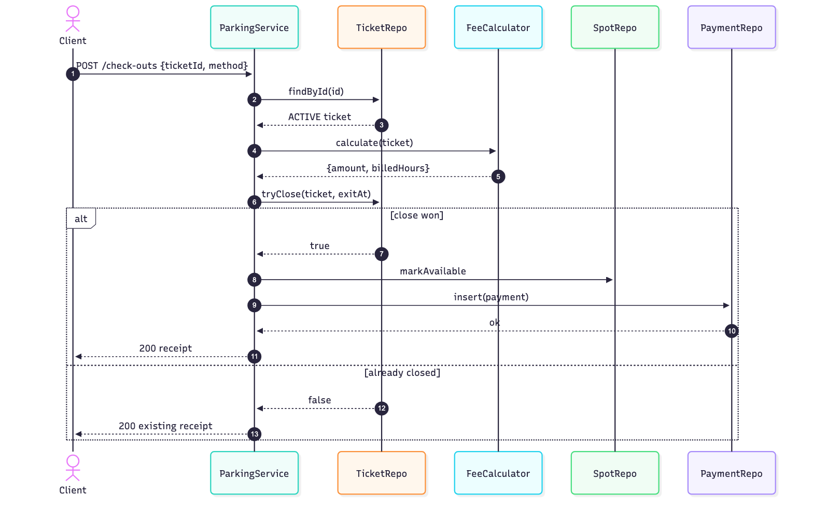

# Smart parking lot - low level design

Ankit Kumar Singh · October 2026

Entry, exit, spot allocation and billing for a single multi-floor lot.

I wrote this before the code, then changed two things along the way. Both are
called out where they happen, so the reasoning is not lost. The code in `src/` follows this document, and `docs/schema.sql` is the
schema it targets.

---

## 1. What the brief does not say

The brief asks for spot allocation, check-in/out, fees and live availability. It
does not say what happens when the lot is full, how a "bus spot" differs from a
"car spot", or whether a car may use a bigger bay. Those three answers shape
everything else, so here is what I picked and why.

**Sizes are ordered, and a vehicle may use a bigger bay but never a smaller one.**
A spot is MOTORCYCLE, COMPACT or LARGE; a vehicle needs 1, 2 or 3 units of room.
Fitting is `spot.capacity >= vehicle.space`, one comparison instead of a
vehicle-by-spot matrix. Adding a fourth size later is a one-line change rather
than an edit in every branch.

The trade-off is that cars can end up in bus bays. Section 3 explains how the
allocator pushes them towards smaller bays, and section 8 is honest about where
that still fails.

**One lot, no bookings.** A car parks now or is turned away. No queue, no
reservation. Both are reasonable features and neither is in the brief, so adding
them would have meant inventing requirements.

**Fees are hourly, rounded up, with a daily cap.** Rounding up is what paid lots
around me do. The cap is not a discount, it is the price list: 25 hours at
₹30/hour would be ₹750 for a day that costs ₹300.

**A vehicle registry exists.** This one I was not sure about. A ticket could just
store the plate as text and nothing would break. I kept the table because a
returning plate keeps its vehicle class, history can join on a stable
`vehicle_id`, and there is somewhere to put a blacklist flag later. If none of
those are wanted, the table should go - a table no query reads is just something
to migrate.

Out of scope on purpose: reservations, EV charging, valet, monthly passes,
refunds, GST invoices, multiple lots. Section 8 lists them again with the reason.

---

## 2. The model



A ticket is the record of one stay. It holds the entry time, the exit time and
the amount that was charged. I freeze the amount at checkout on purpose: if the
price list changes next month, last month's receipts must not change with it.

Everything else in the design follows from two rules:

1. A spot has at most one open ticket.
2. A vehicle has at most one open ticket.

Section 5 is entirely about keeping those two true when several cars arrive at
the same moment. They are enforced by the database, not by a check in the service.

Both objects have a small lifecycle, and I kept the transitions inside the
objects so no caller can invent one:



A ticket only moves forward: `ACTIVE --close--> CLOSED`. A closed ticket stays
closed; a retried exit reads it instead of opening a second one.

Taking an occupied spot out of service is refused. The car leaves first.

### Value objects

`Money` holds integer paise, so `Money.of(12.5)` throws instead of quietly
becoming ₹12.50. `LicensePlate` uppercases and strips whitespace once, at the
boundary, because `"KA 01 AB 1234"` and `"ka01ab1234"` must not become two
vehicles.

I did not build `ParkingLot` and `Floor` as aggregates in the code. Spots carry a
`floorNumber` and nothing needs to load a whole floor. If a "close this floor for
cleaning" feature shows up, `Floor` becomes a real entity; until then it is a
grouping on a report.

### Where each rule lives

| Rule | Where |
|---|---|
| What fits where | `domain/types.ts` |
| Legal spot transitions | `ParkingSpot` |
| Legal ticket transitions | `Ticket` |
| Which spot to try first | `BestFitAllocationStrategy` |
| What a stay costs | `HourlyFeeCalculator` + `PricingTable` |
| Order of operations, retries | `ParkingService` |
| At most one open ticket | `TicketRepository` + the DB indexes |

There is no `if` about vehicle sizes or prices in the service. I moved those out
because I wanted to add a second allocation rule later without editing the
service, and that second rule turned out to be a ten-line class.

---

## 3. Allocation

The strategy ranks candidates; the service claims them. That split is the part I
changed after writing it once.

```
rankCandidates(spots, vehicleType):
  candidates = spots where isFree and spot.capacity >= vehicle.space
  sort by (floorNumber, capacity, code)
  return candidates
```

Nearest floor first, then the smallest bay that fits. Three things come out of
that ordering:

- A car takes a COMPACT bay before a LARGE one, so bus bays stay available for
  buses.
- The result is deterministic. Same lot and same arrivals give the same spot, so
  a failing test is reproducible and support can replay a complaint.
- It is cheap. Sorting in memory, or one ordered index scan with `LIMIT 1` in
  Postgres.

### Why it returns a list

My first version returned a single spot: `allocate(): ParkingSpot`. That is
wrong in a way that only shows up under load. Between ranking and claiming,
another request can take that exact spot. With one return value the service has
no second choice, so it either reports "lot full" wrongly or reruns the strategy
with a growing list of exclusions. Returning the ranked list puts the retry where
the state is:

```
for candidate in ranked:
    if tryMarkOccupied(candidate.id):   # atomic compare-and-set
        insert ticket
        return ticket
    # someone else has this one, try the next
raise LotFull
```

A failed claim means that one bay is gone, not that the lot is full. Separating
those two was worth the refactor; conflating them passes every single-threaded
test and then turns cars away while empty bays sit behind them.

### The choice I made against walking distance

Floor is compared before capacity, so a car takes a LARGE bay on floor 1 instead
of a COMPACT bay on floor 2. I chose walking distance over bay preservation on
purpose, but the cost is real: on a busy day cars can fill every LARGE bay
downstairs while COMPACT bays upstairs stay empty, and the next bus is refused.
A stricter version would look for the smallest capacity anywhere in the lot
before upsizing. I did not build it because it slows the common case to fix
something a "reserve N bays for buses" setting handles more directly. Both are in
section 8.

### The other option

First-fit, lowest code, is simpler but has a quiet problem: with the `F1-M/C/L`
naming it takes COMPACT bays for motorcycles, because `C` sorts before `M`. That
is why `FirstFitAllocationStrategy` exists in the code - it is the comparison, and
there is a test showing the difference.

Optimal assignment (matching all waiting cars to all bays) makes no sense here.
Arrivals are one at a time, so there is nothing to batch.

---

## 4. Fees

Hourly, rounded up to the next started hour, minimum one hour, optional daily
cap. Rates are in a table so changing them does not mean changing code.

| Vehicle | Hourly | Daily cap |
|---|---|---|
| Motorcycle | ₹10 | ₹100 |
| Car | ₹30 | ₹300 |
| Bus | ₹60 | ₹600 |

```
minutes  = max(0, exit - entry)
if minutes <= grace: return 0
hours    = max(1, ceil(minutes / 60))
if no daily cap:  return hours * hourly
fullDays = floor(hours / 24)
leftover = hours % 24
return fullDays * dailyCap + leftover * hourly
```

Examples from the tests:

- Car, 10:00 to 12:15. That is 135 minutes, so 3 started hours, **₹90**.
- Car, 10:00 Monday to 11:00 Tuesday. 25 hours is one capped day plus one hour,
  **₹330**. The naive `25 x 30 = ₹750` is what the cap exists to prevent.
- Car, 48 hours. Two capped days, **₹600**.

Clamping the duration at zero matters more than it looks. A clock skew, a
timezone mistake or a forged exit time must not produce a negative bill, so the
worst case is a free stay, not a refund.

Money is integer paise everywhere. A receipt that is off by a paisa because of a
float is a bad first impression.

If more rules are wanted later - lost ticket fine, peak pricing, GST breakup,
pro-rated passes - they go into `FeeCalculator` and the service does not change.
That is the only reason the interface exists.

---

## 5. Concurrency

There are four races that matter:

| # | Race | What breaks | Defence |
|---|---|---|---|
| 1 | Two cars claim one spot | a double-booked bay | atomic claim + unique index |
| 2 | One car checks in twice | two open tickets, two bills | unique index on active vehicle |
| 3 | One ticket checked out twice | double charge | conditional close + idempotent payment |
| 4 | Spot claimed, ticket insert fails | bay stuck forever | transaction, or compensate |

### The claim is a compare-and-set

```sql
UPDATE parking_spots SET status = 'OCCUPIED'
 WHERE id = $1 AND status = 'AVAILABLE';
-- 0 rows affected: someone else won, try the next candidate
```

The port is `tryMarkOccupied(id): boolean`, not `markOccupied(id): void`. A setter
hides the race; returning a boolean forces the caller to deal with the false
branch, which is also where the retry loop lives.

### The database refuses the bad states

```sql
CREATE UNIQUE INDEX ux_ticket_active_spot
  ON tickets (spot_id) WHERE status = 'ACTIVE';

CREATE UNIQUE INDEX ux_ticket_active_vehicle
  ON tickets (vehicle_id) WHERE status = 'ACTIVE';
```

These are partial unique indexes: only open tickets participate, so a spot can
have years of history but only one live ticket. Even if the service has a logic
bug, two open tickets for one spot cannot exist. The in-memory repository applies
the same two rules in `insert`, so it is not possible for the service to depend on
"I checked a moment ago".

### Don't serialise the whole lot

In Postgres the find-and-claim is one statement:

```sql
SELECT id FROM parking_spots
 WHERE status = 'AVAILABLE' AND capacity >= $1
 ORDER BY floor_number, capacity, code
 FOR UPDATE SKIP LOCKED
 LIMIT 1;
```

`SKIP LOCKED` is the part worth knowing about. Without it, fifty simultaneous
check-ins queue behind the same row and throughput collapses; with it, each
transaction locks a different candidate.

### Retries where a client can retry

- Closing a ticket uses `WHERE status = 'ACTIVE'`. A retried checkout finds it
  already closed and returns the original receipt.
- Payments carry an idempotency key with a unique index, and only one row per
  ticket can be SUCCESS.
- A repeated check-in for the same plate hits the vehicle index and comes back as
  `ALREADY_PARKED`.

### The leak

If the spot is claimed and the ticket insert then fails, the bay is OCCUPIED with
no ticket pointing at it. That is silent capacity loss: the lot reports full with
empty bays, weeks later, with no obvious cause.

There are two ways to deal with it. One is a single transaction around both
writes, which is what `schema.sql` assumes. The other is compensation: on any
failure, release the spot before rethrowing. The service does the second because
the in-memory repositories have no transaction, and there is a test that forces
the insert to fail and checks the bay comes back.

Neither is enough on its own in production. Processes die between writes, and the
database cannot know that a car left, so a reaper job is needed: close ACTIVE
tickets older than N hours and free their spots. It is not built here.

### What concurrency means in Node

Node runs one thread, so a synchronous method body cannot be interleaved with
another request. That is why `checkIn` has no mutex - there would be nothing for
it to protect, and adding one would just be decoration. What needs protecting is
the space between processes, and that is what the two unique indexes and the
conditional UPDATE do.

I tested that rather than assuming it. Two hundred check-ins fired at fifty bays
produce fifty tickets on fifty distinct bays and a hundred and fifty `LOT_FULL`
errors. Two simultaneous check-ins for one plate produce one ticket. There is
also a test that rigs the repository to lose a claim, to show the service moves to
the next candidate instead of reporting a full lot.

One thing I did not test: a second process. Everything above is argued from the
SQL, not measured against it. If I had another day, running the same tests
against a real Postgres repository is the first thing I would do, because that is
where the argument either holds or falls over.

---

## 6. Database



Full DDL in [`schema.sql`](./schema.sql). The choices that are not obvious:

`capacity` is a generated column, so it cannot drift from `spot_type`, and the
allocator can index on it.

`floor_number` is copied onto `parking_spots` next to `floor_id`. The hot query
orders by floor number and joining `floors` to fetch a small integer on every
check-in is not worth it. `floor_id` stays for integrity.

Money is `amount_paise BIGINT`. Not `NUMERIC`, not a float. Currency is INR for
this deployment.

Tickets keep a `rate_snapshot JSONB`. The amount is enough to charge someone but
not enough to answer "why was I charged this" six months later.

There is no `available_count` column. A counter that misses one decrement is
wrong forever, and "the app showed a free spot" is a support ticket. Availability
is a grouped count over an index. If it ever gets hot, cache the snapshot with a
short TTL and rebuild it from the same query rather than inventing a second
source of truth.

History is a query, not a table: `(vehicle_id, entry_at DESC)` gives per-vehicle
history without a list to keep in sync.

`tickets` is not partitioned by month. At one lot's volume that is premature, and
at city volume it is the first thing I would add.

---

## 7. Entry, exit, API

```
POST /api/v1/check-ins           { plate, vehicleType }
  201 { ticketId, plate, spotCode, entryAt }

POST /api/v1/check-outs          { ticketId, method }
  200 { ticketId, spotCode, entryAt, exitAt, billedHours, amountPaise, paymentId }

GET  /api/v1/availability
  200 { free, total, lines: [{ floorNumber, spotType, free, total }] }

POST /api/v1/spots/{id}/out-of-service
  204
```

Errors carry the code from `src/domain/errors.ts`, so the HTTP layer only maps
them:

| Code | HTTP | When |
|---|---|---|
| `LOT_FULL` | 409 | nothing in the lot can take this vehicle |
| `ALREADY_PARKED` | 409 | plate already has an open ticket |
| `DUPLICATE_ACTIVE_TICKET` | 409 | lost a race, constraint fired |
| `UNKNOWN_TICKET` | 404 | no such ticket |
| `TICKET_NOT_ACTIVE` | 409 | exiting a closed ticket |
| `VEHICLE_TYPE_MISMATCH` | 422 | plate registered as a different class |
| `SPOT_UNAVAILABLE` | 409 | bay taken or already out of service |

Check-in:



Check-out:



The order matters: the bay is freed before payment is recorded. If the gateway is
down the car should still be able to leave. The money is a separate problem and
can be retried with the same idempotency key.

That case is tested, because I got it wrong first: closing the ticket and then
failing the payment left a ticket that could never be paid, and a retry was
rejected. `checkOut` now settles a closed-but-unpaid ticket instead of refusing
it.

---

## 8. Limits and what I did not build

Cars can take LARGE bays on a lower floor while COMPACT bays are free upstairs,
and the next bus is turned away. The fix is a reserved-bay count per floor or a
two-pass allocator that looks for a smaller capacity anywhere before upsizing. I
did neither, because both cost something in the common case to fix an edge case.
It should still be written down rather than discovered in production.

Availability is correct per request, but with several API instances the "push an
update to connected clients" part needs a shared bus such as Redis pub/sub. The
in-process listener in `src/ports/events.ts` only works for one instance.

Not built:

- Reservations and a waiting queue. New state the brief does not describe.
- Payment gateway. The model supports PENDING to SUCCESS; the code stops at
  recording a success.
- Refunds and partial charges.
- Multi-lot tenancy. Every table would need a `lot_id`; that is a schema-wide
  decision, not a feature.
- HTTP controllers and dependency wiring. The service is constructed directly in
  the tests; a controller would only translate the error codes above.
- Operator roles and fee waivers. Real lots need a manager who can override a
  charge, and that is an audit-log feature.

If I had more time:

1. A reaper for abandoned tickets, with a test that the spot comes back.
2. A Postgres repository behind the same ports and the concurrency test run
   against it. That would replace an argument with a measurement.
3. A second `FeeCalculator` for peak pricing, mostly to check the interface is
   actually replaceable.
4. A nightly report of bays OCCUPIED with no open ticket, and tickets closed
   with no payment.

---

## 9. Requirements check

Where each line of the brief is answered, and the test that covers it.

| Requirement | Design | Tests |
|---|---|---|
| Assign a spot by vehicle size | §3, `BestFitAllocationStrategy` | `allocation.test.ts` |
| Upsizing, never downsizing | `spotFitsVehicle` | `allocation.test.ts` |
| Record entry and exit times | `Ticket`, `ParkingService` | `parkingService.test.ts` |
| Fee from duration and vehicle type | §4, `HourlyFeeCalculator` | `fee.test.ts` |
| Real-time availability | `availability()` + event publisher | `parkingService.test.ts` |
| Simultaneous entry and exit | §5 | `concurrency.test.ts` |
| Recovery when payment fails | §7 | `paymentRecovery.test.ts` |

---

## Code map

```
src/domain/       entities and value objects, no I/O
src/allocation/   ranking strategies
src/pricing/      rate table and fee calculator
src/ports/        repository, clock and event interfaces
src/infra/        in-memory implementations
src/service/      orchestration
tests/            allocation, fees, flows, failure recovery, concurrency
docs/schema.sql   the schema this design targets
docs/diagrams/    diagram sources (.mmd) and exported PNGs
```

`npm test` runs the suite, `npm run typecheck` compiles with strict mode.
